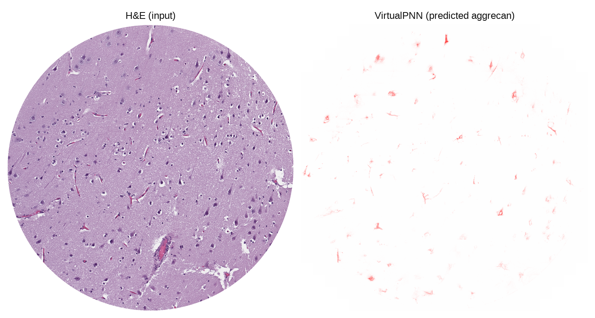
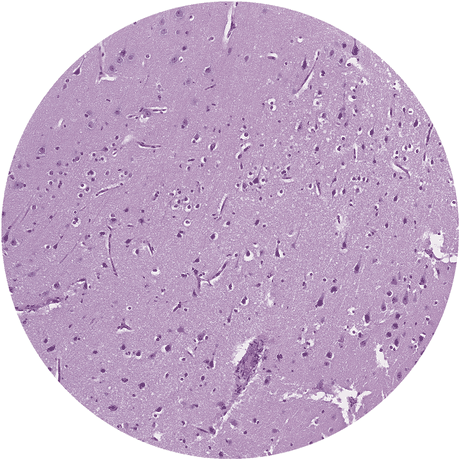
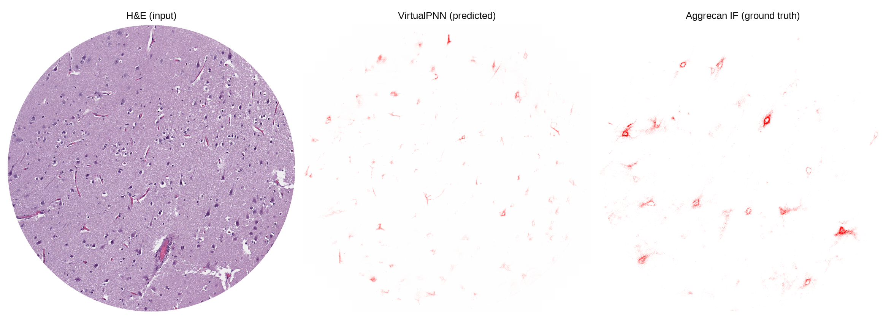

# VirtualPNN

Predict aggrecan-like perineuronal-net (PNN) staining from routine H&E of human brain tissue.



<p align="center">
  
</p>

<p align="center"><sub>
A 1536-pixel tissue core held out from training, predicted by the fold that never saw it.
This core is the median of 25 by the number of perineuronal nets a published WFA detector
finds in the prediction: a typical result, not the best one. Predictions are shown at native
windowing: perineuronal-net images here are never contrast-stretched or gamma-adjusted.
</sub></p>

VirtualPNN is a Contrastive Unpaired Translation (CUT) generator (Park et al., ECCV 2020)
fine-tuned from AI-FFPE, with a VGG16 perceptual loss and an **anti-vessel loss** that
suppresses the spurious aggrecan signal CUT paints onto blood vessels. The paper calls it
VirtualPNN-P+AV. It is released as five cross-validation fold models, with the generators of
the paper's four comparators.

This code accompanies: Natarajan V, Shukla T, Palisoul S, Sadanandappa M, Lin C-C, Zanazzi G,
Hong J, Hassanpour S. *Unpaired generative virtual aggrecan staining of perineuronal nets from hematoxylin and eosin-stained sections of human brain*. Acta
Neuropathologica Communications (in revision).

**What the output means.** In the paper the model reproduces the amount and appearance of
aggrecan staining more closely than the comparators (lowest Frechet distance and KID on the
paper's folds, also in a pathology foundation-model feature space not used in training; the
closest cohort-mean stained area; on patient-grouped folds at equal steps the distance advantage over
the perceptual-only variant did not persist) and suppresses off-target signal on vessels and
hypocellular tissue. It did not establish cell-level placement or per-core abundance: on a
section imaged for aggrecan and then restained with H&E, per-cell discrimination of PNN-positive
from PNN-negative neurons is near chance (AUROC about 0.54), whole-core pixel correlation with the
real stain is about 0.05 to 0.07, and per-core correlations of virtual with real staining have
intervals that include zero. The core above, beside its real aggrecan immunofluorescence:



Read the output as an appearance model of aggrecan staining, not a per-cell or per-core PNN measure. Intensities are not calibrated
to stain concentration, so compare regions within an image or a case. The model was trained on
one institution's brain tissue; other organs, stains or H&E protocols are untested.

## Install

```bash
git clone https://github.com/hong-lab-dartmouth/VirtualPNN.git
cd VirtualPNN
conda env create -f environment.yml && conda activate virtualpnn
```

Or `pip install -r requirements.txt` into an environment whose PyTorch matches your CUDA driver.
Python 3.8 or newer. A GPU is recommended, not required.

## Get the weights

```bash
./fetch_weights.sh                  # or: ./fetch_weights.sh path/to/VirtualPNN_weights_v1.0.zip
```

This downloads `VirtualPNN_weights_v1.0.zip` (1.4 GB) from this repository's v1.0 release, checks the SHA-256 of the archive and of
every file in it against `WEIGHTS_MANIFEST.csv`, and writes `weights/<run name>/latest_net_G.pth`.
The five `VirtualPNN_AV6_Fold*` generators are the model. The others are the ablation, the three
baselines and the AI-FFPE base (for retraining only).

## Run on your own images

```bash
python infer.py --input my_images/ --output predictions/
```

`--input` is a file or a directory (searched recursively). The five folds of VirtualPNN-P+AV
(`VirtualPNN_AV6_Fold*`) are averaged and one PNG is written per input, at its own size. Options:
`--run-name` (another released model: `VirtualPNN_noAV`, `CUT`, `AIFFPE`), `--folds 1 2 3`,
`--device cpu`, `--batch-size`, and `--overlap 32`, which blends tile seams but is not the
validated configuration.

## Reproduce the paper

| To check | Look in |
|---|---|
| the training command of each of the 25 runs | `scripts/runtrain_VirtualPNN_*.sh`, `scripts/baselines/runtrain_*.sh` |
| every option each run recorded at launch | `scripts/train_opt/` (each run's `train_opt.txt`, verbatim) |
| the trained generators of all 25 runs | `fetch_weights.sh`, `WEIGHTS_MANIFEST.csv` |
| test commands and post-processing | [INFERENCE.md](INFERENCE.md), `scripts/TEST_VirtualPNN_AV6_Fold1.sh`, `scripts/baselines/TEST_*.sh` |
| what differs between VirtualPNN-P and VirtualPNN-P+AV besides the loss | [TRAINING.md](TRAINING.md), `scripts/train_opt/` |

The evaluation analyses of the paper read the study's tissue images and model outputs, which are
patient data. They are described in the paper's Supplementary Information and are not part of this
repository; their scripts are available from the authors on request.

## Train

[TRAINING.md](TRAINING.md) gives each model's settings. Every run fine-tunes the AI-FFPE base
for 20 + 20 epochs at batch size 8 on unpaired 256-pixel patches. VirtualPNN-P is not a
one-factor ablation of VirtualPNN-P+AV. It also lacks the vessel sampler and ran 2.9 to 4.0 times
fewer generator steps. GAN training is stochastic: retraining reproduces the method, not the weights.

## Patient-grouped check

The paper also reports a patient-grouped check: eight recipes retrained on five folds of whole
patients, including CycleGAN and AI-FFPE at equal generator steps and learning rate. Those runs are
not released. The design and results are in the paper's Supplementary Information.

## Names

| Paper | Run name | Released file |
|---|---|---|
| VirtualPNN-P+AV | `VirtualPNN_AV6_Fold{k}` | `VirtualPNN-P+AV_Fold{k}_net_G.pth` |
| VirtualPNN-P | `VirtualPNN_noAV_Fold{k}` | `VirtualPNN-P_Fold{k}_net_G.pth` |
| CUT, CycleGAN, AI-FFPE | `{CUT,CycleGAN,AIFFPE}_Fold{k}` | `{CUT,CycleGAN,AI-FFPE}_Fold{k}_net_G.pth` |

The model class is `--model virtualpnn`; the runs' `train_opt.txt` record its earlier name, `cut`.

## Layout

```
infer.py       run the model on your own images
test.py        paper inference on the cross-validation splits (fake_B beside real_B)
train.py       training entry point
models/        virtualpnn_model.py (the model and its losses), cycle_gan_model.py, networks.py
data/          loaders for unpaired H&E / aggrecan patches and the vessel sampler
options/       option parsers
util/          framework utilities
postprocess/   reconstruct_noa.py (patches to cores), signal_ratio.py (stained-pixel fraction)
scripts/       per-fold train and test commands (baselines/), recorded options (train_opt/)
tests/         unit tests and a check with real weights
```

## Tests

```bash
python -m pytest tests/                                                   # no weights, data or GPU
VPNN_TEST_WEIGHTS=weights python -m pytest tests/test_weights_smoke.py    # with fetched weights
```

They cover tiling, seam blending, the intensity round-trip, fold discovery and the generator's key
set, which is pinned to the released checkpoints. See [CONTRIBUTING.md](CONTRIBUTING.md).

## License and citation

Our code is BSD 3-Clause ([LICENSE](LICENSE)). It is forked from
[AI-FFPE](https://github.com/DeepMIALab/AI-FFPE), built on
[CUT / pytorch-CycleGAN-and-pix2pix](https://github.com/taesungp/contrastive-unpaired-translation),
whose licenses are in [LICENSES/](LICENSES/); [THIRD_PARTY_NOTICES.md](THIRD_PARTY_NOTICES.md)
says which parts came from where. The trained weights are under CC BY 4.0. Please cite the paper
([CITATION.cff](CITATION.cff)).
